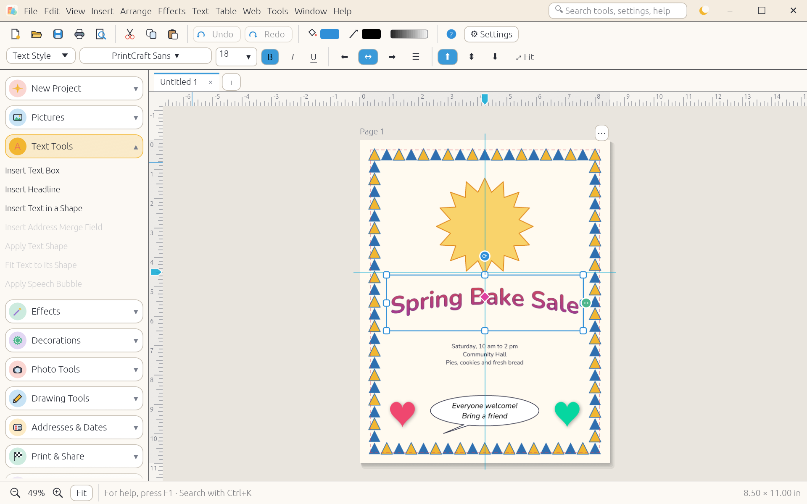
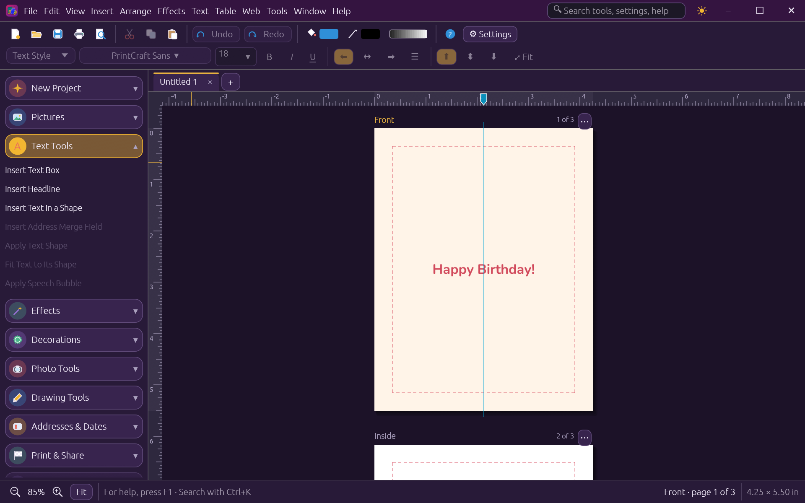

# PrintCraft



**Cards, Signs, Banners and Labels for Everyone - Written in Rust.**

A friendly home-publishing app: make greeting cards, signs, banners, labels, certificates, envelopes and more,
then print them at home. It has a classic, easy-to-learn layout, with a tool panel on the left, rulers, and the page
in the middle. It runs on Windows, macOS and Linux, and in the browser.



> [!WARNING]
> **PrintCraft is young and rough around the edges.** It's a hobby project, and you should expect bugs. Save your
> work often (PrintCraft also keeps safety copies and offers them back after a crash).

## About this project

I'm not a software developer. I made PrintCraft for my mom, who designs cards, signs and invitations and wanted a
simple program she already knows how to use, on a current version of Windows. It was built mostly by AI (Claude),
with me testing it and steering.

PrintCraft is inspired by the ArtCraft apps (PhotoCraft, LightCraft, WordCraft and others) but isn't part of that
family. I don't plan to spend a lot of time on it. Bug reports are welcome, but replies and fixes may be slow or may
never come. If PrintCraft is close to what you need, fork it and make it your own.

## Features

* **18 kinds of project**: signs and posters, banners, greeting cards (quarter-fold and half-fold), note cards,
  calendars, labels, envelopes, business cards, certificates, letterheads, newsletters, brochures, postcards, fax
  covers, scrapbook pages, stickers and iron-on transfers, each with its paper size and panels (Front / Inside /
  Back for cards).
* **Text**: text boxes, headlines with 17 effects (blends, outlines, shadows, neon, perspective…) and arch, wave
  and bulge bends, text inside 28 shapes, speech bubbles, seals, large initial capitals, numbers and handwritten
  signatures.
* **Fonts**: every font on your computer, two bundled open fonts, and free online fonts from
  [Fontsource](https://fontsource.org/) with previews. Use the arrow keys in the font list to try fonts on your
  text as you go.
* **Pictures**: type what you want in the search box under **Pictures** and press Enter: Google Images opens in a
  PrintCraft window, and every picture you click **+ Add to my project** on goes straight onto your page. Or paste
  (Ctrl+V) or drop pictures in, use a file, your own **My Art** folder, art collections you already own (`.CDT`
  packs), or a picture drawn by AI from a description (optional; uses your own free Google Gemini or OpenAI key).
* **Photo Editor**: crop with a box you drag on the photo, turn, color and recolor, light and focus, red-eye fix,
  effects picked from previews of your own photo, and cut-outs: a shape you move and stretch with handles, a magic
  wand, drawing around something, picking a color, or automatic background removal. The parts that will be cut
  away show faded, so you can keep picking more. Undo, Start Over and Hold to Compare are always at hand.
* **Design tools**: shapes, lines, 16 page borders, flourishes and dividers, page color and patterns (with an
  adjustable size), drop shadows, glows, frames, tint and see-through, groups, align and space evenly, snapping,
  ruler guidelines and a printable-area guide. Lines and outlines can be any thickness (or none) and solid, dashed,
  dotted, double, wavy, zigzag or scribbled. Drag things from one page to another.
* **Ready-made designs** for cards, signs, certificates, banners, labels, envelopes, business cards, letterheads,
  newsletters, postcards and scrapbook pages, shown next to Blank in New Project.
* **Calendars that fill in their dates**, one page per month, with holidays and birthdays from the address book.
* **Address merge**: put «Name» or «Address» on a label or envelope, then print one for each person you tick.
* **Replace Picture** swaps a picture while keeping its place, size and effects.
* **Any paper size**: File > Page Setup offers Letter, Legal, Tabloid, A3, A4, A5, photo sizes or your own size,
  tall or wide, and can scale your design to fit.
* **Printing that knows the project**: folded cards come out the right way up, banners tile across sheets,
  labels and business cards fill standard sheets (common US letter and A4 stock), with a print preview, copies,
  page ranges, two-sided printing, cut marks and a printer test page.
* **Opens older projects**: reads older `.sig`-style project files (`.sig`, `.car`, `.hcr`, `.ban`, `.lbl` and
  more). The paper size, words, pictures and fonts come across; see [Opening older projects](#opening-older-projects).
* **Saves** as a PrintCraft design (`.pcraft`), PDF, PNG, JPEG or BMP.
* Classic and Modern layouts, light and dark looks (or follow the computer), project tabs, an address book with
  birthday reminders, searchable help, and autosave with crash recovery.
* **Keeps itself up to date**: once a day (or from Help > Check for Updates) PrintCraft looks for a new version
  and offers to download and install the same kind of package you have.
* **Report a problem or suggest an idea** from the Help menu: a short form that opens a GitHub issue with the
  details already filled in and gathers a picture of the window to attach.

<details>
<summary>The dark look, with a three-panel greeting card</summary>



</details>

## Download

Get the latest version from [Releases](https://github.com/amruthwo/PrintCraft/releases):

| Platform | x86_64 | arm64 | Formats |
|---|---|---|---|
| Windows | ✓ | ✓ | .msi installer (x86_64), setup .exe, portable .zip |
| macOS | ✓ | ✓ | one universal .dmg and zipped .app (Apple Silicon and Intel) |
| Linux | ✓ | ✓ | .deb, .rpm, .flatpak, .AppImage, portable .tar.gz |
| Web | wasm32 | | runs in the browser, can be installed as an app |

**Try it in your browser:** <https://amruthwo.github.io/PrintCraft/>. You can design, open projects and pictures
(or drop them on the page), and saving or printing downloads the file. Settings are kept in the browser. Content
packs, My Art, the Google Images window, online fonts and AI pictures need the desktop app.

The installers aren't code-signed. On **Windows**, SmartScreen may say "Windows protected your PC": choose
*More info → Run anyway*. On **macOS**, right-click the app and choose *Open* the first time.

On Linux, the Google Images window needs WebKitGTK 4.1 (the `.deb`, `.rpm` and Flatpak bring it along). Without it,
the search opens in your web browser instead, and PrintCraft picks up pictures you copy there.

## Getting started

1. **Start a project.** When PrintCraft opens, choose *Start a New Project*, pick what to make (a card, sign,
   banner, label…), then the size and direction. *Just Start Designing* gives you a blank sign.
2. **Add things to the page.** Open a group in the tool panel on the left (Pictures, Text Tools, Decorations…)
   and click a tool. New items appear in the middle of the page.
3. **Arrange them.** Click an item to select it, drag it to move, drag the small squares to resize (hold Shift to
   keep its shape) and drag the round handle to turn it. Right-click anything for more choices. Double-click text to
   change the words; the bar above the page sets font, size, style and alignment.
4. **Work on the other panels.** A card has Front, Inside and Back pages, shown one under another (or side by
   side, or one at a time: see *Settings > Pages*).
5. **Print.** *File > Print* (Ctrl+P) shows a preview of each sheet. Cards are laid out to fold correctly; for
   half-fold cards, put the first sheet back in blank side up when PrintCraft asks. Use *Print a Test Page* once to
   see how close to the edge your printer can reach, and set it in *Settings > Printable area*.
6. **Save.** *File > Save* (Ctrl+S) keeps a `.pcraft` design you can change later. *Save as PDF* makes a copy to
   email or print anywhere.

Press **F1** (or use the search box at the top, Ctrl+K) to find any tool, setting or help topic. Sliders follow
the mouse wheel or trackpad, and the arrow keys once you've clicked them.

### Keyboard shortcuts

| Keys | Does |
|---|---|
| Ctrl+N / Ctrl+T | New project / new tab |
| Ctrl+O / Ctrl+S / Ctrl+P | Open / save / print |
| Ctrl+W | Close the tab |
| Ctrl+Z / Ctrl+Y | Undo / redo |
| Ctrl+C / Ctrl+X / Ctrl+V | Copy / cut / paste (pictures and text from other programs paste too) |
| Ctrl+D | Duplicate |
| Ctrl+G / Ctrl+Shift+G | Group / ungroup |
| Ctrl+B / Ctrl+I / Ctrl+U | Bold / italic / underline |
| Ctrl+A | Select everything on the page |
| Arrow keys | Nudge the selection (1/16 inch) |
| Delete | Remove the selection |
| Ctrl + / Ctrl − (or + / −) | Zoom the page in / out |
| Ctrl+0 or Ctrl+F | Fit the page in the window |
| Ctrl+K | Search tools, settings and help |
| F1 | Help |

On macOS, use ⌘ instead of Ctrl.

### Opening older projects

*File > Open* reads older `.sig`-style project files. PrintCraft brings in the paper size, the words, the
pictures and the fonts used, and lays them out in order down the page for you to arrange (their exact positions
can't be read yet). *Edit > Project Notes* lists what came across. PrintCraft can't save in those formats; save
your work as a `.pcraft` design.

If you own `.CDT` art and photo collections, open the **Content Packs** tab of the Pictures window (Insert >
From Content Packs) and add the folders that hold them (desktop only). Their pictures then show up there,
searchable by name. Nothing is copied; PrintCraft reads them where they are.

[docs/FORMATS.md](docs/FORMATS.md) describes what is known about these formats. Help in decoding more of them is
very welcome.

### Where your things are kept

* Designs go wherever you save them.
* **My Art** is a plain folder, `Pictures/PrintCraft Art`, that you can open and tidy yourself.
* Settings, downloaded fonts and safety copies live in PrintCraft's own data folder
  (`%APPDATA%\PrintCraft\PrintCraft` on Windows, `~/Library/Application Support/org.PrintCraft.PrintCraft` on
  macOS, `~/.config/printcraft` and `~/.local/share/printcraft` on Linux; in the browser version, the browser's
  storage for the site).
* PrintCraft only goes online when you use an online feature (Google Images, online fonts, AI pictures). An AI key
  you enter stays on your computer and is only sent to the service you chose.

## Build from source

```sh
cargo build --release
./target/release/printcraft
```

Linux needs the window and web-engine development packages first (Fedora:
`sudo dnf install gtk3-devel webkit2gtk4.1-devel libxkbcommon-devel`; Debian/Ubuntu:
`sudo apt install libgtk-3-dev libwebkit2gtk-4.1-dev libxkbcommon-dev`).

The browser version: `rustup target add wasm32-unknown-unknown`, `cargo install trunk`, then
`trunk serve web/index.html`.

Every platform is built by `.github/workflows/release.yml` when a `v*` tag is pushed, and the web version is
published to GitHub Pages by `.github/workflows/pages.yml`. See [docs/DEVELOPING.md](docs/DEVELOPING.md) for how
the code is laid out, local packaging (`cargo packager`, `cargo generate-rpm`, `flatpak-builder`) and the
check-picture switches.

## Command line

```
printcraft [design.pcraft | project.sig | picture.png]
printcraft --export project.sig out.pdf        # convert without opening a window (PDF or PNG)
printcraft --screenshot out.png                # picture of the window with a sample design, then quit
```

## Roadmap

Tables, mixed styles inside one text box, more ready-made designs, and exact placement when opening older
projects. See [docs/ROADMAP.md](docs/ROADMAP.md).

## Licence

PrintCraft is free software: you can redistribute it and/or modify it under the terms of the GNU General Public
License as published by the Free Software Foundation, either version 3 of the License, or (at your option) any
later version. See [LICENSE](LICENSE).

The bundled fonts (Nunito and Dancing Script) are under the SIL Open Font License; see
[THIRD-PARTY-NOTICES.md](THIRD-PARTY-NOTICES.md).

## Not affiliated

PrintCraft is an independent project. It ships no templates, clip art or fonts from any other product, and it
isn't affiliated with, endorsed by or sponsored by the makers of any other design software, or by ArtCraft or its
authors. File formats are supported only so people can keep using their own files. Other names are used only to
say what inspired PrintCraft.
